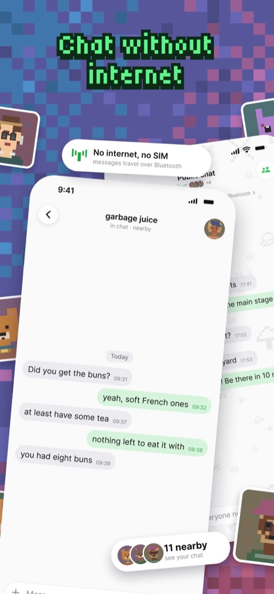
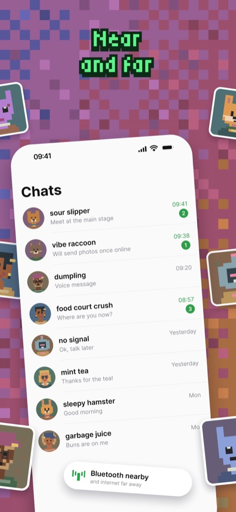
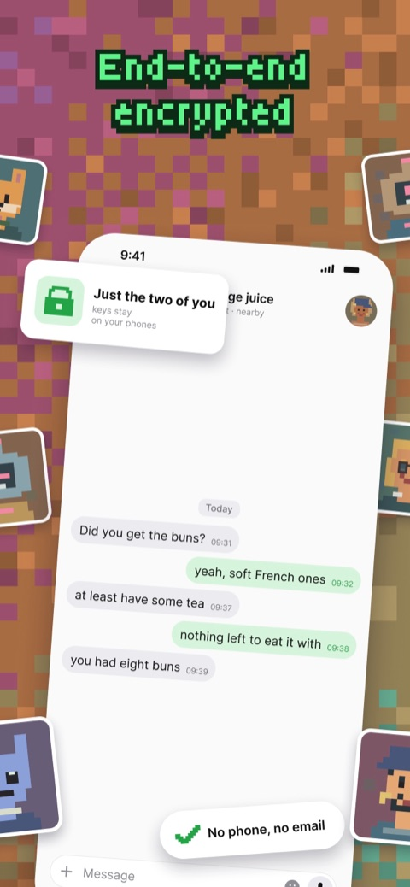
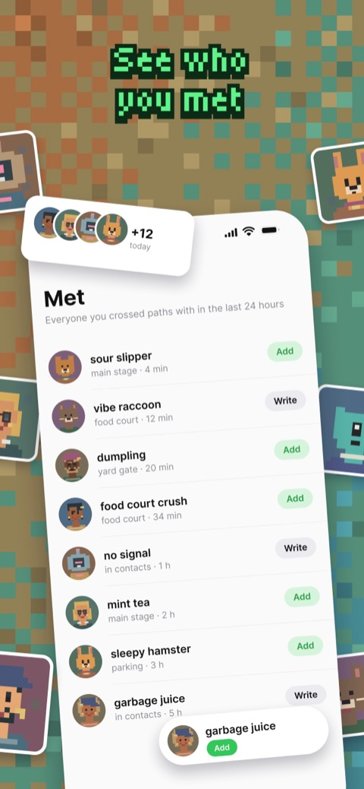

  

<h1 align="center">Shum for iPhone</h1>

  Chat with people nearby over Bluetooth and far away through independent Nostr relays. 
  No phone number, no email.

  
  
  

  English · <a href="README.ru.md">Русский</a>

  
  
  
  

## Download

[Shum on the App Store](https://apps.apple.com/app/id6816236820), for iPhone with iOS 16 or later. The badge above shows the version on sale now.

Shum also runs on the computer and in the browser: [desktop app and Shum Web](https://github.com/hiTechTeam/Shum-App), [terminal client](https://github.com/hiTechTeam/Shum-CLI). One profile works on all of them.

## Features

- **Without internet.** Text messages travel over Bluetooth between phones nearby.
- **Near and far.** With internet, messages go through independent Nostr relays.
- **End-to-end encryption.** Keys stay on your devices; history is encrypted on the device.
- **Met.** People you crossed paths with during the last 24 hours, ready to add.
- **No phone number.** A name is enough. Add people from a QR card, a link or their network ID.
- **Your devices.** Link Shum on the computer, the browser or the terminal to the same profile.
- **Backups.** Save a profile to a password-protected file or restore it as another profile.
- **Privacy.** App passcode, Face ID or Touch ID, hidden chats in the app switcher.
- **Pixel avatars** made on the device, or your own photo.

Saving a contact and accepting a chat invitation are separate actions. A developer-operated server sends push notifications without receiving message text.

## Project

Open `ShumiOS.xcodeproj` in Xcode. Message logic lives in the shared Rust core, [Shum-Core](https://github.com/hiTechTeam/Shum-Core); the app shows it. Dependencies and upstream revisions are recorded in the repository. Third-party code retains its original licenses.

[Protocol](https://github.com/hiTechTeam/Shum-Protocol) · [Rust core](https://github.com/hiTechTeam/Shum-Core) · [Desktop and web](https://github.com/hiTechTeam/Shum-App) · [CLI](https://github.com/hiTechTeam/Shum-CLI) · [Upstream sources](Upstreams/README.md)

## Support and policies

[getshum.tech](https://getshum.tech) · [Issues](https://github.com/hiTechTeam/Shum-iOS/issues) · [Privacy](PRIVACY.md) · [Terms](TERMS.md)

## License

[MIT](LICENSE.md), © 2021–2026 Ruslan Chukavin. [Third-party licenses](Upstreams/README.md), including the [Bluetooth Unlicense](BLUETOOTH-LICENSE), remain applicable.
