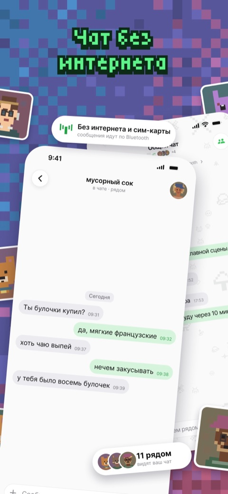
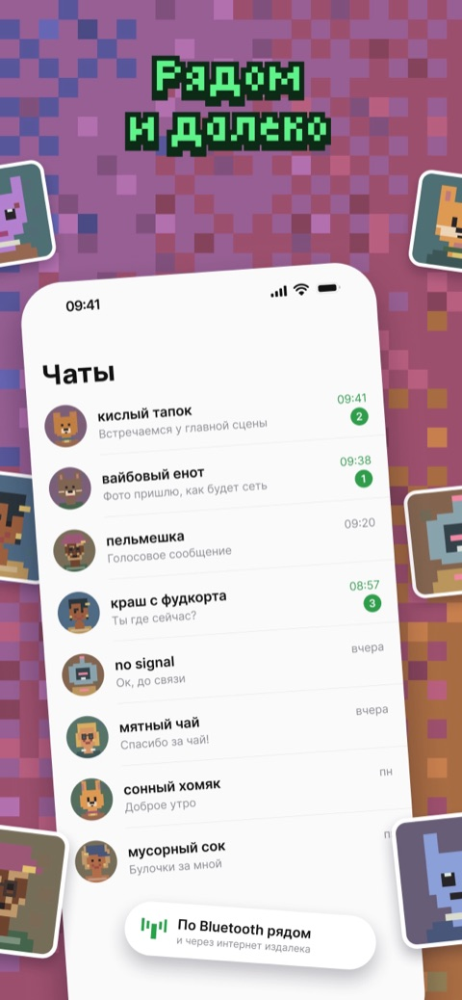
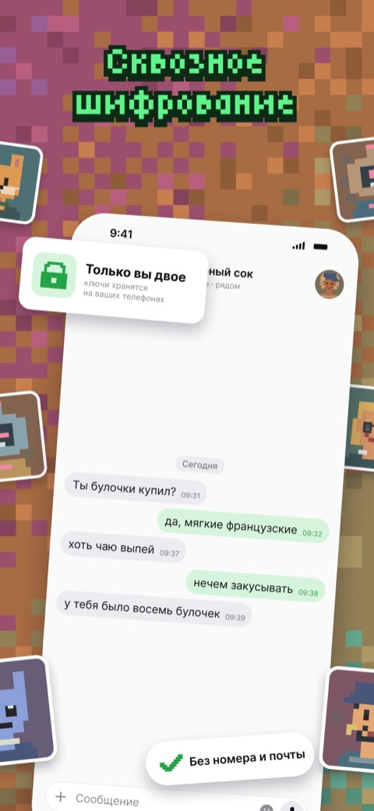
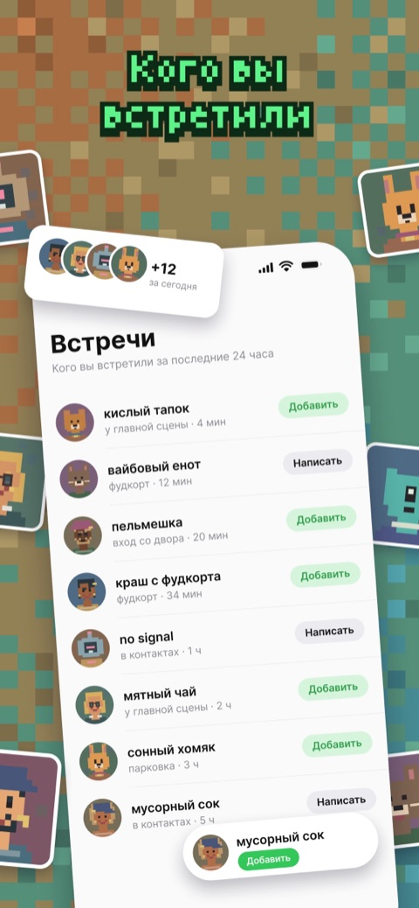

  

<h1 align="center">Shum для iPhone</h1>

  Общайтесь с людьми рядом по Bluetooth и на расстоянии через независимые релеи Nostr. 
  Без номера телефона и почты.

  
  
  

  <a href="README.md">English</a> · Русский

  
  
  
  

## Скачать

[Shum в App Store](https://apps.apple.com/app/id6816236820), для iPhone с iOS 16 и новее. Бейдж выше показывает версию, которая сейчас в продаже.

Shum работает и на компьютере, и в браузере: [приложение для компьютера и Shum Web](https://github.com/hiTechTeam/Shum-App), [клиент для терминала](https://github.com/hiTechTeam/Shum-CLI). Один профиль работает везде.

## Возможности

- **Без интернета.** Текстовые сообщения идут по Bluetooth между телефонами рядом.
- **Рядом и далеко.** С интернетом сообщения идут через независимые релеи Nostr.
- **Сквозное шифрование.** Ключи хранятся на ваших устройствах, история зашифрована на устройстве.
- **Встречи.** Люди, с которыми вы пересеклись за последние 24 часа, их можно сразу добавить.
- **Без номера телефона.** Достаточно имени. Людей можно добавить по QR-карточке, ссылке или сетевому ID.
- **Ваши устройства.** Привяжите к тому же профилю Shum на компьютере, в браузере или в терминале.
- **Резервные копии.** Сохраните профиль в файл с паролем или восстановите его как ещё один профиль.
- **Приватность.** Код приложения, Face ID или Touch ID, скрытые чаты в переключателе приложений.
- **Пиксельные аватары**, созданные на устройстве, или ваше фото.

Сохранение контакта и принятие приглашения в чат происходят отдельно. Сервер разработчиков отправляет push-уведомления, не получая текст сообщений.

## Проект

Откройте `ShumiOS.xcodeproj` в Xcode. Логика сообщений живёт в общем ядре на Rust, [Shum-Core](https://github.com/hiTechTeam/Shum-Core); приложение её показывает. Зависимости и ревизии внешних проектов записаны в репозитории. Сторонний код сохраняет свои лицензии.

[Протокол](https://github.com/hiTechTeam/Shum-Protocol) · [Ядро Rust](https://github.com/hiTechTeam/Shum-Core) · [Компьютер и веб](https://github.com/hiTechTeam/Shum-App) · [CLI](https://github.com/hiTechTeam/Shum-CLI) · [Внешние источники](Upstreams/README.ru.md)

## Поддержка и правила

[getshum.tech](https://getshum.tech) · [Issues](https://github.com/hiTechTeam/Shum-iOS/issues) · [Конфиденциальность](PRIVACY.md) · [Правила использования](TERMS.md)

## Лицензия

[MIT](LICENSE.md), © 2021–2026 Руслан Чукавин. [Лицензии сторонних компонентов](Upstreams/README.ru.md), включая [Unlicense для Bluetooth](BLUETOOTH-LICENSE), сохраняются.
